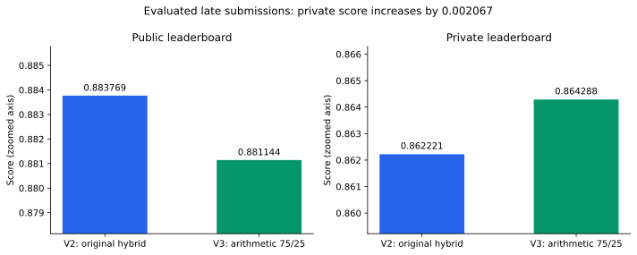
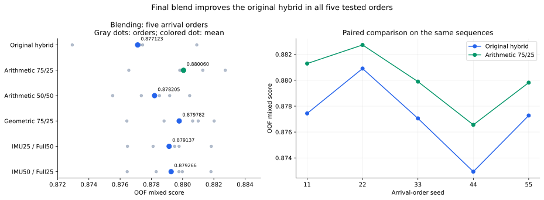
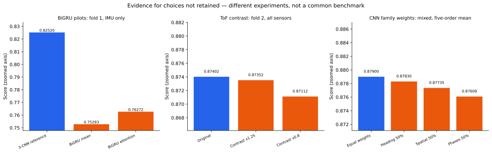

# CMI Sensor Behavior Recognition

**Multimodal gesture recognition with CNN ensembles and collection-protocol-aware sequential assignment.**

A personal, approximately one-month post-competition study by **Angelis Steve Nguele**, using wrist-worn inertial, thermal and time-of-flight measurements from [CMI — Detect Behavior with Sensor Data](https://www.kaggle.com/competitions/cmi-detect-behavior-with-sensor-data).

## Results

The final submission achieved a **0.864288 private leaderboard score**. Compared with the official leaderboard shown at evaluation, this score falls between the **11th (0.864332)** and **12th (0.862901)** entries, within the gold-medal score range.

This is a post-competition score comparison, not an official competition rank or medal.

| System | Public leaderboard | Private leaderboard |
|---|---:|---:|
| Original hybrid — submission V2 | 0.883769 | 0.862221 |
| Final arithmetic blend — submission V3 | **0.881144** | **0.864288** |

| OOF evaluation, mixed sensor availability | Original hybrid | Final arithmetic blend |
|---|---:|---:|
| Sequence-ID order within each participant | 0.874678 | **0.878749** |
| Mean across five fixed random arrival orders | 0.877123 | **0.880060** |

OOF means out-of-fold: each sequence is predicted by models trained without its validation participants. Arrival-order experiments use the same sequences; they test order sensitivity rather than provide five independent datasets.



## Problem and data

The training set contains **8,151 sequences from 81 participants**, with **18 gesture labels**.

The sensor modalities are:

- **IMU:** acceleration and orientation measurements.
- **THM:** five thermal sensor channels.
- **ToF:** five spatial grids, each containing **8 × 8 distance pixels**, recorded over time.

The task distinguishes eight target behaviors and ten non-target gestures. The evaluation combines binary target/non-target F1 with macro F1 over the eight target classes and a collapsed non-target class.

Our evaluation takes the predicted 18-class gesture first, then collapses non-target gestures for the nine-class metric.

## Approach

### 1. Sensor preprocessing and CNN representations

Three original model variants — **spatial**, **phases** and **heading** — form an equal-weight ensemble.

The pipeline includes IMU feature construction, fold-specific preprocessing, handedness handling, modality availability masks and temporal sequence preparation. The CNN systems use temporal convolutions; ToF grids are processed with spatial encoders.

The phases variant predicts three temporal phases from IMU and uses phase-weighted temporal averaging. The architectures also include residual and squeeze-and-excitation blocks.

The final system uses **no GRU or Transformer**. The BiGRU pilots and their measured results are documented below.

### 2. Composite prediction targets

A separate CNN predicts **102 situations**, combining:

1. Initial behavior: moves, or relaxes and moves.
2. Body orientation.
3. Gesture.

The collection protocol contains **51 observed orientation–gesture combinations**, each with two initial behaviors. Complete participants have 102 distinct situations. Some participants have incomplete coverage.

### 3. Combining gesture and situation probabilities

Let:

- `p(g)` be the original three-CNN ensemble probability of gesture `g`.
- `r(s)` be the composite CNN probability of situation `s`.
- `m(g)` be the composite probabilities summed over situations belonging to gesture `g`.

The original hybrid preserves the ensemble's gesture probabilities and uses the composite model's conditional distribution within each gesture.

The final blend uses:

```text
gesture_probability(g) = 0.75 * p(g) + 0.25 * m(g)

situation_probability(s)
    = gesture_probability(gesture(s)) * r(s | gesture(s))
```

Here `r(s | g)` is obtained by normalizing the composite model's probabilities within gesture `g`. Zero-mass groups use a uniform conditional fallback.

### 4. Sequential assignment per participant

Predictions are processed as sequences arrive. For each participant, the observed prefix is assigned to distinct situations by minimizing summed negative log-probabilities with the Hungarian algorithm.

Only the currently arriving sequence's gesture is returned. Earlier internal assignments may change when solving a later prefix, but previously emitted predictions are not revised. No future sequences are used.

## Validation

- Five participant-disjoint folds.
- Separate IMU-only, all-sensor and fixed mixed-availability conditions.
- A fixed mixed-availability mask for comparable experiments.
- Sequence-ID order and five random arrival orders using seeds **11, 22, 33, 44, 55**.
- Sequential prefix evaluation rather than treating a full-participant assignment as deployable online inference.
- Checkpoint and preprocessing reproduction checks before submission.

Final arithmetic-blend OOF means across the five random orders:

| Sensor condition | Score |
|---|---:|
| IMU only | 0.853020 |
| All sensors | 0.906139 |
| Fixed mixed availability | 0.880060 |

Weights were compared on these OOF results. These are development comparisons, not a separate nested evaluation of the weight-selection procedure.

## Experiments and findings



The points are scores for five arrival orders of the same OOF sequences, not confidence intervals. Plot means are recomputed from the reported six-decimal scores and can differ by one unit in the last decimal from means computed before rounding.

- Independently, the composite model scored **0.80474 IMU / 0.86197 full / 0.83651 mixed**, versus **0.81900 / 0.87749 / 0.85032** for the initial ensemble. Its conditional situation probabilities nevertheless improved sequential assignment.
- Adding 25% composite gesture contribution improved five-order means from **0.848736 to 0.853020 IMU**, **0.902116 to 0.906139 full**, and **0.877123 to 0.880060 mixed**.
- A 50% composite gesture contribution reached **0.878206 mixed**, below **0.880060** for 25%. The geometric 75/25 alternative reached **0.879782**. The arithmetic 75/25 blend was selected for its highest tested mean.
- Under the intermediate **12.5% composite gesture contribution**, equal CNN-family weights gave **0.878998** mixed mean. Giving heading, spatial or phases 50% weight gave **0.878298**, **0.877345** and **0.876086**, respectively. These tests support equal family weights within that configuration; they do not establish an optimum over all possible weights.
- On fold 2 with all sensors, ToF contrast factors **1.0 / 1.25 / 0.8** scored **0.87402 / 0.87352 / 0.87112**. Factor 1.25 corrected **12** nine-class errors but lost **15** correct predictions. It changed no nine-class predictions for the inspected participant, SUBJ_032165. This specific inference transformation was not retained; it does not rule out geometry as a source of difficulty.
- For SUBJ_058967, all **24 side-lying sequences** had invalid quaternions at every time step; the other inspected postures had valid quaternions. This finding localizes missing rotation, but does not quantify its causal effect.
- An audit of **612 sequences from six selected participants** found no missing/extra repetitions within the observed gesture–posture groups, no exact duplicate complete sensor sequences, and no structural counter/phase-order anomalies under the implemented checks. These checks did not establish semantic label correctness.


### Why the BiGRU pilots were not retained

On **fold 1, IMU only**, the mean-pooling BiGRU scored **0.75283**, and the attention-pooling BiGRU scored **0.76272**, against the existing three-CNN reference at **0.82520**. Their 50/50 blends with the reference scored **0.80397** and **0.80945**, respectively: neither improved it.

These pilots changed architecture and specialization relative to the reference, and compare single models with an ensemble. They justify not retaining those tested pilots, **not a general claim that GRUs or attention are inferior**.



### Evidence and figure reproduction

- [Reported score data](results/reported_scores.csv): transcribed from experiment outputs and evaluated submission screenshots supplied during this study.
- [Figure-generation script](scripts/plot_results.py): requires Python and Matplotlib; run `python scripts/plot_results.py` from the repository root.
- Each figure specifies its evaluation scope. The BiGRU, contrast and family-weight experiments use different conditions and must not be compared as a common benchmark.
- This initial evidence package contains reported aggregates, not the underlying complete experiment logs, checkpoints or per-sequence predictions. These will be linked or imported with the final source files.

Exploratory analyses using annotated phases or same-participant labeled repetitions are diagnostic studies. They are not presented as submission-time predictors.

## Lessons

1. Reconstruct the experiment and conditions that generated the data.
2. Investigate plausible mechanisms behind observed difficulties.
3. Represent measurements in a way that respects their physical structure.
4. Read the problem statement and understand the role of each data source.
5. Prefer simplicity and justify additional components through measured contributions.
6. Turn concrete hypotheses into experiments, make decisions and stop exhausted lines of investigation.
7. Design validation to match the intended prediction conditions.
8. Evaluate complementarity in the complete system.
9. Preserve code, preprocessing, checkpoints, predictions and experiment provenance.

## Repository status and reproduction

This initial repository documents the final method and verified results.

**The final training and submission source files have not yet been imported into this repository.** Runnable instructions, environment specifications and artifact locations will be added after checking them against the evaluated V3 notebook. This repository is not yet a complete reproduction package.

Competition data and trained weights are not included in this initial commit.

## Acknowledgements

This study benefited from the competition's public discussions and solution write-ups.

In particular, the **second-place solution write-up** supplied the idea of composite 102-situation targets and no-repeat assignment. This project verifies the collection structure, adapts that idea to its CNN pipeline and evaluates hybrid probability construction and sequential blending.

The **first-place solution write-up** also informed investigations of sensor preprocessing and geometry.

Exact source links and code-origin details will be recorded alongside the imported source files.

## Author

**Angelis Steve Nguele**
